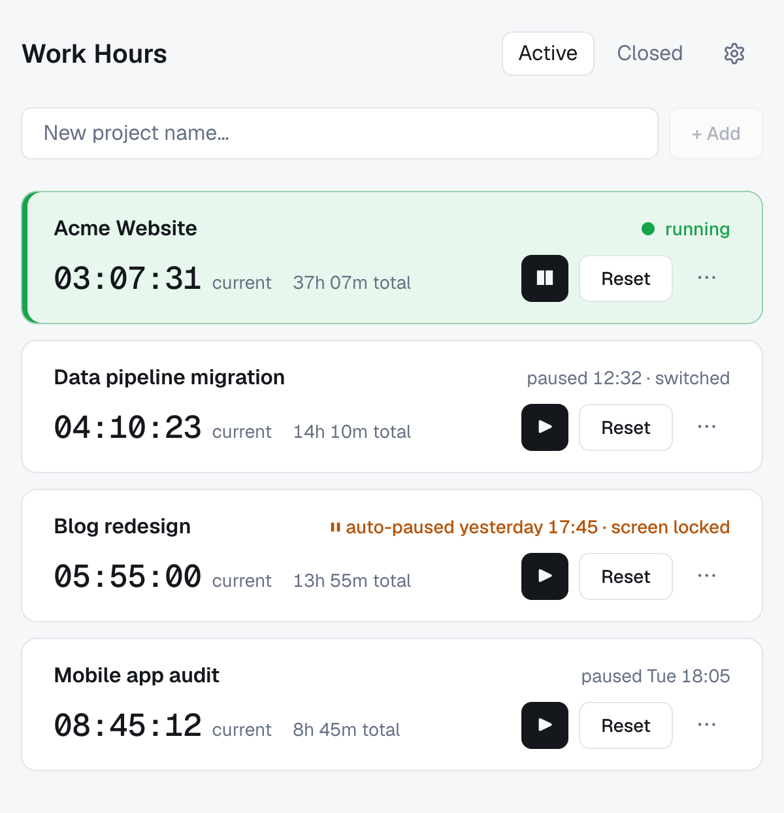
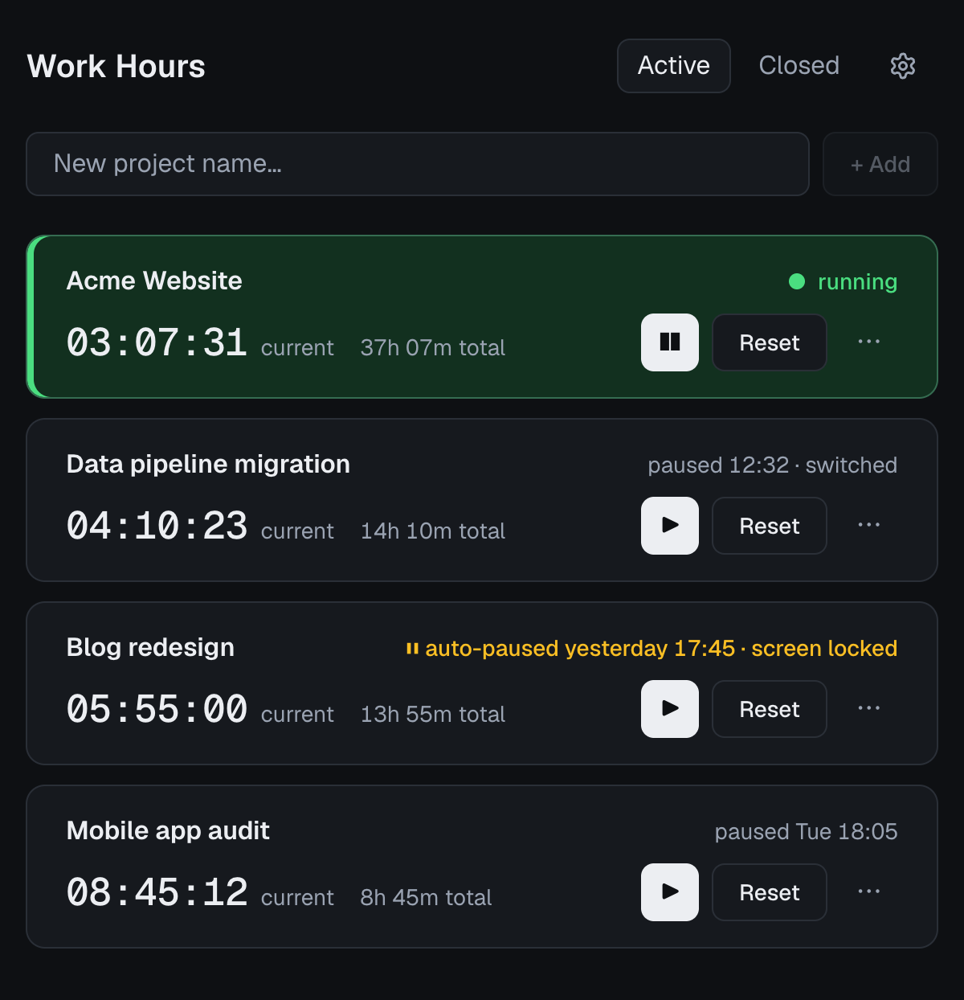

# Work Hours

 

Work Hours tracks time on the client projects you juggle during the day. Start a project, switch to another when the first one is waiting on something, and pause for breaks. When it's time to bill, copy the hours and minutes into your client's system.

Work Hours watches out for the usual mistakes. If you walk away and forget to pause, it pauses for you. When you come back, it calls you with a sound and a notification. While a timer runs, a soft chime reminds you which project is being counted.

> **Status:** version 0.1. Every feature in [REQUIREMENTS.md](REQUIREMENTS.md) is built. The two sounds and their minimum volume are still being tuned, and Windows and Linux are untested.

## What you need

- **Google Chrome.** Work Hours works only in Chrome. It relies on two Chrome features that other browsers don't have: knowing when you're away from your computer, and notifications with buttons. Opened in another browser, Work Hours shows a page asking you to use Chrome.
- **Node.js 24 or newer.** Check with `node --version`. Get it from [nodejs.org](https://nodejs.org) or a version manager such as nvm, fnm or Homebrew.
- **macOS, Windows or Linux.** Work Hours is developed and tested on macOS. Windows and Linux should work but are untested. On Linux, away detection depends on your desktop environment, and some Wayland desktops may not support it.

## Good to know before you start

- **It runs only on your computer.** A small server runs in a terminal, and you use it in a Chrome tab. Nothing is sent anywhere. There's no account or login, and other devices can't reach it.
- **It runs only when you start it.** There's no autostart. Leave the terminal running: closing it, or pressing Ctrl+C, stops Work Hours and pauses any running timer.
- **Keep the Work Hours tab open.** It can sit in the background in any Chrome window. The tab is what notices you're away and what plays the alerts. If you close it and don't reopen it within 60 seconds, the running timer pauses as of when you closed it.
- **It makes sounds, and they can't be turned off.** While a timer runs, a soft chime plays every 10 minutes (you can choose 5, 10 or 15). An alert tone plays when something needs you. You can lower the volume but not silence it. That's deliberate: the sounds are how Work Hours keeps your hours accurate.
- **It pauses by itself when you're not working:**

  | When | The timer stops as of |
  |---|---|
  | You close the Work Hours tab or Chrome (and don't reopen it within 60 s) | when the tab closed |
  | Your computer goes to sleep | when it went to sleep |
  | You lock the screen | when you locked it |
  | No keyboard or mouse use anywhere on the computer for 10 minutes | your last keystroke or mouse move |
  | The Work Hours server stops | when it stopped |

  When you're back, a notification tells you what happened. Choose **Count** (the button shows the time it adds, such as **Count the 45m**) if you were working on the project away from the computer (a meeting, a call, a whiteboard). Choose **Resume** to carry on without it; starting the project any other way does the same. The same choices wait at the top of the Work Hours tab until you pick one.

## Install

Get the code by cloning the repository or copying the project folder. Then, in that folder, run:

```sh
npm install
npm run build
npm link
```

`npm link` adds the `workhours` command to your PATH. If it fails with a permission error, your global npm folder needs admin rights. Installing Node with a version manager (nvm, fnm) avoids this.

`npm install` may warn that `esbuild` and `fsevents` have install scripts "not yet covered by allowScripts". You can ignore it: they're build tools, and the build works without their install scripts.

## Run

```sh
workhours
```

```text
Work Hours running at http://localhost:7420   (Ctrl+C to stop)
```

Chrome opens to Work Hours. If Work Hours is already running, the command just opens the tab.

| Option | What it does | Default |
|---|---|---|
| `--port <n>` | Port to run on. If you change it, use the new port in the Chrome setting below too. | `7420` |
| `--data <folder>` | Where your data is kept | `~/.workhours` |
| `--no-open` | Don't open Chrome | Chrome opens |
| `-h`, `--help` | Show the options | |
| `-v`, `--version` | Show the version | |

To stop Work Hours, press Ctrl+C in its terminal. Any running timer is paused at that moment.

After restarting your computer, run `workhours` again.

## First run: set up alerts

A welcome dialog explains why Work Hours needs sound, notifications and away detection, then walks you through four steps:

1. **Turn on sound.** It plays the chime and the alert tone so you know what they sound like.
2. **Allow notifications.** Chrome asks for permission, then Work Hours sends a test notification.
3. **Allow away detection.** Chrome asks whether Work Hours may know when you're using your device.
4. **Keep this tab active.** This is the Chrome setting described below.

You can skip any step. Work Hours still works, and the status bar shows a ⚠ warning for whatever isn't set up (the tab title starts with ⚠ too). Click the warning to go back to that step, or use **Set up alerts** in Settings.

Then make the one-time system settings below.

## One-time system settings

### 1. Keep the Work Hours tab active in Chrome (required)

Chrome's Memory Saver unloads tabs you haven't looked at for a while. If it unloads Work Hours, the timer is paused and the app can no longer alert you. Tell Chrome to leave it alone:

1. Open `chrome://settings/performance`.
2. Find **Always keep these sites active** and click **Add**.
3. Enter `localhost:7420` (or your port, if you changed it) and confirm.

This is worth doing even if Memory Saver is off: it keeps the tab safe if Memory Saver gets turned on later. If Chrome ever does unload the tab, Work Hours shows a warning the next time you open it.

### 2. Let Chrome show notifications (required)

#### macOS

1. Open **System Settings → Notifications**.
2. Click **Google Chrome** and turn on **Allow notifications**.
3. Set the notification style to **Persistent** (called **Alerts** on older macOS). Otherwise Work Hours alerts disappear after a few seconds instead of waiting for you.
4. If there's also a **Google Chrome Helper (Alerts)** entry, do the same for it.

On macOS, a notification's buttons (for example **Count the 45m** and **Resume**) show only when you hover over it. Click **Options** or **More** to see them. You can also just click the notification to open Work Hours, which shows the same choices.

#### Windows

Open **Settings → System → Notifications** and turn notifications on for **Google Chrome**.

#### Linux

Allow notifications from Chrome in your desktop's notification settings.

### 3. Focus and Do Not Disturb (optional)

While a Focus mode or Do Not Disturb is on, the operating system holds notifications back, but Work Hours' sounds still play. To get Work Hours notifications during Focus, add **Google Chrome** to the apps allowed to notify you. On macOS that's **System Settings → Focus → (your Focus) → Allowed apps**.

### 4. Sound

- **Volume:** keep your computer's volume audible.
- **Don't mute the tab:** don't use **Mute site** on the Work Hours tab.
- **After a reload or a Chrome restart:** Chrome blocks sound from a page until you click on it. Work Hours shows **⚠ Sound is off. Click to turn on.** at the top; click it, or click or press a key anywhere in the page. If you don't within a minute, a notification reminds you.

## Daily use

- **Start** (▶) a project to time it. Starting another project pauses the first one. The running project's card moves to the top, and stays there while you're on a break or Work Hours has paused it.
- **Pause** is for any break: lunch, end of day, a pause mid-project. **Resume** picks up the last project, or you can just start a different one.
- **When each project stopped** shows on its card: `paused 12:30` after you paused, `paused 10:30 · switched` after you started another project, or `⏸ auto-paused 15:00 · screen locked` (in amber) when Work Hours paused it because you were away. Hover over it for the full date.
- **Started earlier? / Stopped earlier?** appears for 30 seconds after you start, switch or pause. Use it if you actually switched a few minutes before you clicked. The minutes move to the right project.
- **The check-in chime** plays while a timer runs. If you hear it and the wrong project is running, switch now and use **Started earlier?**.
- **Reset** a project once you've entered its time into the client's system. The dialog shows separate **hours** and **minutes** boxes with **Copy** buttons. Leftover seconds stay on the counter for next time. The project's total is kept.
- **Adjust time** (in the ⋯ menu) adds or removes minutes, with a reason. Use it for anything the automatic checks missed. It can't take a project below zero, because time already reset has been billed.
- **History** (in the ⋯ menu) lists a project's resets and adjustments.
- **Close** a finished project (it asks you to confirm). Time that hasn't been reset is reset first, and the dialog shows the **hours** and **minutes** to copy, as Reset does. To leave time unbilled, take it off with **Adjust time** before closing. The project moves to **Closed projects**, which shows its total time and history. You can **Reopen** it from there. A closed project keeps its name, so a new project can't use it. To work on that project again, reopen it.
- **Settings** (⚙) has the check-in interval, the volume (with **Play chime** and **Play alert tone**), a checklist of what's protected with **Set up alerts** and **Send test alert**, where your data is, and export.
- **Keyboard:** `N` new project, `Space` pause or resume, `1`–`9` start a project by the order you added it, so the card at the top keeps its own number. Hover over ▶ to see a card's number.
- **Tab title** shows the running timer, such as `01:42 · Acme Website`, so you can see it from any tab.

## Your data

- **Location:** everything is in one file, `~/.workhours/workhours.db`. On Windows that's `C:\Users\<you>\.workhours\workhours.db`. Use `--data` to keep it somewhere else.
- **Backups:** a copy is saved every day in `~/.workhours/backups/`, and the last 14 are kept.
- **Export:** Settings has **Export JSON** (everything) and **Export CSV** (reset history).
- **Moving to another computer:** stop Work Hours, then copy the `~/.workhours` folder across.

## Troubleshooting

| Problem | What to do |
|---|---|
| "Work Hours needs Google Chrome" | Open `http://localhost:7420` in Chrome. |
| "Work Hours needs Node.js 24 or newer" | Update Node (see [What you need](#what-you-need)). |
| "Port 7420 is used by another program" | Run `workhours --port 7421`, and add `localhost:7421` to Chrome's **Always keep these sites active** list. |
| No sound | Click anywhere in the Work Hours tab; until you do, it shows **⚠ Sound is off**. Check the tab isn't muted and your computer's volume is up. |
| No notifications | In Chrome, click the icon to the left of the address bar → **Site settings** → **Notifications: Allow**. Then check the OS settings in [step 2](#2-let-chrome-show-notifications-required), and whether a Focus mode is on. |
| Notifications disappear by themselves (macOS) | Set Google Chrome's notification style to **Persistent** ([step 2](#2-let-chrome-show-notifications-required)). |
| "Away detection is off" warning | Open `chrome://settings/content/idleDetection` (shown as **Your device use**) and allow `localhost:7420`. |
| "Chrome unloaded this tab" warning | Add the **Always keep these sites active** exception ([step 1](#1-keep-the-work-hours-tab-active-in-chrome-required)). |
| The timer paused when you didn't expect it | The notice says why: tab closed, computer slept, screen locked, no input for 10 minutes, or Work Hours stopped. Choose **Count** if you were working. |
| "Work Hours server isn't running" alert | Run `workhours` again in a terminal. |
| Not sure whether alerts work | Open Settings: the **Alerts** checklist shows what's protected. **Send test alert** plays the tone and shows a notification. |

## Uninstall

1. Stop Work Hours with Ctrl+C.
2. Run `npm uninstall -g work-hours` to remove the `workhours` command.
3. Remove `localhost:7420` from Chrome's **Always keep these sites active** list.
4. Delete `~/.workhours` **only if you no longer need your time records**. It holds all your data and backups.

## For developers

```sh
npm run dev          # server with auto-restart + Vite dev server
npm test             # unit and API tests
npm run test:e2e     # builds, then runs the end-to-end tests in your installed Chrome
npm run screenshots  # builds, then retakes the screenshots at the top of this README
npm run typecheck    # TypeScript and Svelte checks
npm run lint         # ESLint and Prettier (npm run format fixes formatting)
```

- `npm run dev` serves the UI at `http://localhost:5173`, with the API on port 7420. It keeps its data in `.dev-data/`, not `~/.workhours`, so development never touches your real time records. Saving a server file restarts the server, which pauses a running timer as "Work Hours stopped".
- The end-to-end tests run the built app on port 7498 with a fresh `.e2e-data/` folder each time. They drive your installed Google Chrome, so Playwright downloads nothing.
- `npm run screenshots` makes up four projects in a temporary database, runs the built app on port 7499, and photographs it in Chrome. Your own data and a Work Hours running on 7420 aren't touched. It takes about 40 seconds.

What the app must do is in [REQUIREMENTS.md](REQUIREMENTS.md), how it's built is in [DESIGN.md](DESIGN.md), and why things are the way they are is in [DECISIONS.md](DECISIONS.md).
